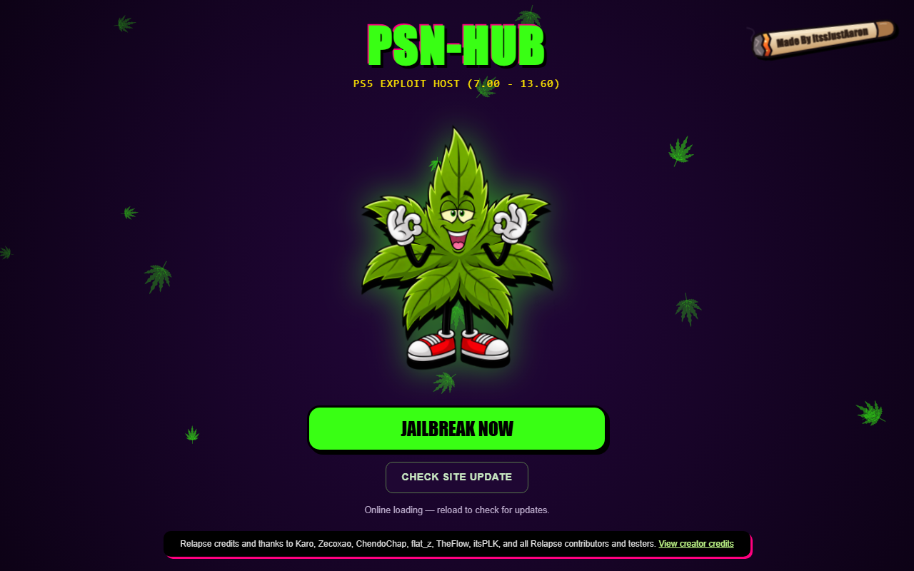

# PSN-HUB

PSN-HUB is a Relapse jailbreak host for supported PS5 firmware. After jailbreak, it starts PSN-HUB Manager, a dashboard served by the console that you can open on your PS5, phone, or computer.

[Open PSN-HUB](https://itssjustaaron.github.io/PSN-HUB2/) · [Download Manager ELF](https://raw.githubusercontent.com/ItssJustAaron/PSN-HUB2/main/payloads/PSN-HUB-Manager.elf) · [Report an issue](https://github.com/ItssJustAaron/PSN-HUB2/issues)



## Current release

**Manager 0.4.1** adds game names and icons to the Saves tab and introduces the private Community Saves pilot. Console save browsing, USB backups, advanced save tools, and shortcut artwork are included in one `PSN-HUB-Manager.elf`. The [build manifest](Manager/build.json) records the current UI release, catalogue version, and ELF SHA-256.

## Getting started

1. On a supported PS5, open the [PSN-HUB jailbreak page](https://itssjustaaron.github.io/PSN-HUB2/).
2. If you have used an older build, choose **Check Site Update** and follow the page status before choosing **Jailbreak Now**. Fully restart the PS5 first if an older Manager is still running.
3. After jailbreak, the page sends the Manager ELF automatically and opens its dashboard once it is reachable.
4. To use Manager on another device, open `http://<PS5-IP>:8085/` from a phone or computer on the same trusted local network.

If a transfer fails, follow the retry instructions on the jailbreak page. If the dashboard still looks old, check the native engine and loaded UI versions in Manager's maintenance panel. Manager serves HTTP on port **8085**, and elfldr receives payloads on port **9021**. Keep both services on your local network.

## Supported PS5 firmware

| Series | Versions |
| --- | --- |
| 7.xx | 7.00, 7.01, 7.20, 7.40, 7.60, 7.61 |
| 8.xx | 8.00, 8.20, 8.40, 8.60 |
| 9.xx | 9.00, 9.20, 9.40, 9.60 |
| 10.xx | 10.00, 10.01, 10.20, 10.40 |
| 11.xx | 11.00, 11.20, 11.60 |
| 12.xx | 12.00, 12.02, 12.20, 12.40, 12.60, 12.70 |
| 13.xx | 13.00, 13.20, 13.40, 13.42, 13.60 |

Each HEN, mod menu, and emulator has its own requirements. Manager hides known incompatible entries by default and shows when compatibility is unknown. Check the entry for firmware, game version, and prerequisites before sending it. [Firmware source](firmware.js)

## What you can do in Manager

| Tab | Features |
| --- | --- |
| **Payloads** | Upload your own `.elf` or `.bin` files, browse payloads stored on your PS5, send them to elfldr, and run saved groups with a delay between sends. |
| **Cheats** | Search PS4 and PS5 cheats by game, title ID, version, format, or creator. Install individual files or versions, or use **Download All** for the full catalogue. |
| **HENs** | Review and send cragson PS5-HEN, etaHEN, and onionHEN. |
| **Mod Menus** | View game and version requirements for mod menus, including RaringM's GTA V Story Mode menu. |
| **Emulators** | View prerequisites and send the PS5SX2 installer. |
| **My Library** | Access favourites and recent actions. |
| **Saves** | Browse console saves, download encrypted files, take snapshots, back up to USB, and open advanced save tools. |
| **Community Saves** | Submit an encrypted save to a private library or prepare an approved save for installation. A library operator must configure the backend. |

Choose the active HEN and confirm the destination before installing cheats. The unified Manager supports `/data/etaHEN/cheats` and `/data/OnionHEN/cheats`, with files grouped by format. It also provides installed-file inventory and cheat backup and restore. Console profiles and display preferences are stored in the browser.

### Saves and USB backups

Close the game before copying or importing saves. The **Saves** tab shows game names and icons when console or catalogue metadata is available, with title IDs as a fallback. Use **View saves / download** for raw encrypted files. Keep each PS4 image with its companion `.bin` file.

Connect a mounted USB drive to export a title or back up all changed saves. Optional automatic USB backups run while Manager is active. See the [console saves and USB guide](native/SAVES.md) for limits and backup locations.

The built-in Garlic SaveMgr engine handles decryption, encryption, resigning, and staged imports. Select the receiving console user and review the staged import before confirming. Manager requires a backup when an existing save would be replaced. Advanced transforms and imports remain experimental. [Advanced save tools](Manager/SAVE-TOOLS.md)

### Community Saves

The pilot uses a separate private library with member and reviewer codes. Reviewers approve submissions before members can download them. To install an approved save, choose **Install & resign**, select the receiving console user, and review the import. The console checks that the save matches the listed title and assigns ownership during installation. [Library setup and testing](Manager/COMMUNITY-SAVES.md)

### Home-screen shortcut and artwork

Manager can set the Store shortcut to **PSN-HUB JAILBREAK**, apply the mascot artwork, and hide the duplicate Media shortcut after a successful replacement. The artwork controls can update the background for an installed PSN-HUB Store shortcut. Backup and restore details are in the [shortcut guide](native/shortcut/README.md) and [background guide](native/shortcut/BACKGROUND.md).

## Offline use

On PS5 browsers that support Application Cache, open the jailbreak page while online and wait for the cache to finish installing. **Check Site Update** refreshes the site's cache. Manager catalogue downloads, artwork fetched from GitHub, and online update checks still need an internet connection.

## Development and hosting

The jailbreak site is static and can be served by GitHub Pages. A fork can publish its root directory from the chosen branch in **Settings → Pages**. The Manager dashboard in this build fetches catalogue and UI files from this repository's `main` branch. If you maintain a separate fork, update the repository URL in [the dashboard template](Manager/dashboard.html) before rebuilding the ELF.

Add library files to `Manager/Hens/`, `Manager/ModMenus/`, `Manager/Emulators/`, or `Manager/Cheats/`. Keep cheat files grouped by format and update [descriptions.json](Manager/descriptions.json) for upstream links, authors, and compatibility.

From the repository root, run:

```sh
python tools/build-manager.py
node tools/check-site.cjs
node tools/test-community-saves.cjs
```

The builder regenerates the catalogue, build manifest, firmware index, and offline cache. It also updates the embedded dashboard in the existing ELF. For native changes, rebuild the ELF using the [native build workflow](.github/workflows/build-native.yml) and see the [native source guide](native/README.md). Publish the generated files and matching ELF together.

Use `node tools/preview-manager.cjs` to preview the dashboard at `http://127.0.0.1:8086`. The preview is read-only. See the [Manager library guide](Manager/README.md) and [native API notes](Manager/NATIVE-API.md) for integration details.

| Path | Purpose |
| --- | --- |
| `index.html`, `relapse.html` | Jailbreak home page and Relapse runner |
| `Manager/` | Dashboard, catalogue, library files, artwork, and guides |
| `payloads/` | Manager ELF and jailbreak payloads |
| `native/` | Manager source, bundled save engine, and native tests |
| `offsets/` | Firmware-specific offsets and generated firmware index |
| `tools/` | Build, preview, validation, and Community Saves server scripts |
| `.github/workflows/` | Build, validation, and release automation |

## Credits

- **PSN-HUB site and Manager** — ItssJustAaron.
- **Relapse jailbreak** — Karo, Zecoxao, ChendoChap, flat_z, TheFlow, itsPLK, and the Relapse contributors and testers.
- **PS5 tools and build tooling** — John Törnblom and the ps5-payload-dev contributors for [elfldr](https://github.com/ps5-payload-dev/elfldr), [ftpsrv](https://github.com/ps5-payload-dev/ftpsrv), [klogsrv](https://github.com/ps5-payload-dev/klogsrv), and the [PS5 Payload SDK](https://github.com/ps5-payload-dev/sdk). Thanks to drakmor for [ShadowMountPlus](https://github.com/drakmor/ShadowMountPlus) and the [SQLite contributors](https://sqlite.org/crew.html).
- **Homebrew enablers** — cragson for [PS5-HEN](https://github.com/cragson/ps5-hen), LightningMods and the [etaHEN team](https://github.com/etaHEN/etaHEN), and aydencharles for [onionHEN](https://github.com/aydencharles/onionHEN).
- **Mods and emulators** — RaringM for the [GTA V mod menu](https://github.com/RaringM/ps5-gtav-menu), Swordpdf for [PS5SX2](https://github.com/Swordpdf/PS5SX2), and the [PCSX2 contributors](https://github.com/PCSX2/pcsx2).
- **Save tools** — earthonion and contributors for [Garlic SaveMgr](https://github.com/earthonion/garlic-savemgr), earthonion for the [Garlic Worker](https://github.com/earthonion/garlic-worker) research reference, and Arjun Barrett (101arrowz) for [fflate](https://github.com/101arrowz/fflate).
- **Cheats and cover art** — the cheat authors credited on individual Manager entries and in the original files. Thanks to TeeKay87 and the [HEN Cheats Collection](https://hencheats.vercel.app/) for catalogue inspiration and cover metadata. Cover images come from the PlayStation CDN and belong to their respective rights holders.
